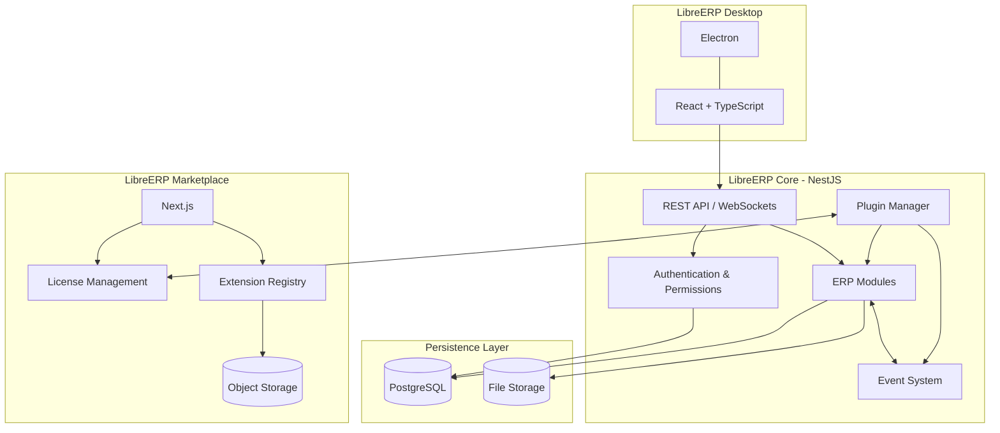

# LibreERP

**Open Source · Modular · Extensible · Desktop ERP**

LibreERP es un proyecto de software ERP de código abierto, diseñado para ofrecer una alternativa moderna, modular y extensible a los sistemas tradicionales de planificación de recursos empresariales.

Construido sobre el ecosistema de **Node.js y TypeScript**, LibreERP busca proporcionar una plataforma instalable en sistemas operativos como Windows y Linux, con capacidad para funcionar localmente o mediante una arquitectura cliente-servidor.

El proyecto busca crear un ecosistema donde empresas y desarrolladores puedan utilizar, personalizar y extender las funcionalidades del ERP mediante módulos y plugins.

## Visión del proyecto

El objetivo de LibreERP es construir un ERP de código abierto que permita:

- Instalar y ejecutar el sistema sin depender de una plataforma web externa.
- Administrar empresas, usuarios, permisos y operaciones comerciales.
- Incorporar funcionalidades mediante módulos independientes.
- Extender el sistema mediante plugins desarrollados por terceros.
- Permitir la distribución de extensiones gratuitas y comerciales.
- Facilitar la integración con servicios y plataformas externas.
- Ofrecer soporte técnico, implementación y mantenimiento empresarial.

## Arquitectura general

LibreERP estará construido bajo una arquitectura **Modular Monolith**, utilizando NestJS como motor principal del ERP.

La aplicación de escritorio se comunicará con el servidor mediante una API, permitiendo utilizar la misma arquitectura tanto en instalaciones locales como en instalaciones centralizadas.

### Diagrama de arquitectura



## Tecnologías principales

| Componente | Tecnología | Responsabilidad |
|---|---|---|
| Desktop | Electron | Aplicación multiplataforma |
| Frontend | React + TypeScript | Interfaz de usuario |
| Backend | NestJS | Motor principal del ERP |
| Database | PostgreSQL | Persistencia de información |
| ORM | Por definir | Acceso y gestión de datos |
| Communication | REST API | Comunicación entre cliente y servidor |
| Real-time | WebSockets | Actualizaciones en tiempo real |
| Events | EventEmitter2 | Comunicación entre módulos |
| Marketplace | Next.js | Plataforma de extensiones |
| Authentication | Supabase Auth | Autenticación del Marketplace |
| Storage | Supabase Storage | Distribución de extensiones |

## Estructura del proyecto 
!!ACTUALIZAR
LibreERP utilizará un monorepo administrado mediante pnpm Workspaces.

```text
libreerp/
│
├── apps/
│   ├── desktop/
│   │   ├── electron/
│   │   ├── src/
│   │   └── package.json
│   │
│   ├── server/
│   │   ├── src/
│   │   └── package.json
│   │
│   └── marketplace/
│       ├── src/
│       └── package.json
│
├── packages/
│   ├── core/
│   ├── database/
│   ├── sdk/
│   ├── plugin-api/
│   ├── plugin-runtime/
│   ├── plugin-manager/
│   ├── licensing/
│   ├── types/
│   ├── ui/
│   └── i18n/
│
├── modules/
│   ├── authentication/
│   ├── companies/
│   ├── users/
│   ├── inventory/
│   ├── sales/
│   ├── purchases/
│   └── accounting/
│
├── extensions/
│   └── example-extension/
│
├── infrastructure/
│   ├── docker/
│   ├── database/
│   └── scripts/
├── licence.md
└── README.md
```

*La estructura representa la organización objetivo del proyecto y podrá evolucionar durante su desarrollo.*

## Componentes principales

### 1. LibreERP Desktop

Aplicación instalable para Windows y Linux, construida con Electron y React.

Responsabilidades:

- Interfaz gráfica del ERP.
- Administración de sesiones.
- Comunicación con el servidor local o remoto.
- Instalación y administración de extensiones.
- Notificaciones y actualizaciones.
- Integración con periféricos y recursos del sistema operativo.

El frontend será independiente del backend, permitiendo reutilizar la interfaz en diferentes modalidades de instalación.

### 2. LibreERP Core

Motor principal del sistema, desarrollado con NestJS.

Se encargará de administrar las operaciones, reglas de negocio y servicios compartidos del ERP.

Responsabilidades:

- Autenticación y autorización.
- Administración de empresas y usuarios.
- Gestión de roles y permisos.
- Administración de módulos.
- Acceso a PostgreSQL.
- Auditoría de operaciones.
- Comunicación mediante eventos.
- Exposición de APIs.
- Gestión del ciclo de vida de extensiones.

El Core utilizará una arquitectura modular para facilitar el mantenimiento y la incorporación de nuevas funcionalidades.

### 3. Database Layer

PostgreSQL será el sistema principal de almacenamiento.

Prisma será utilizado como herramienta de acceso y gestión de datos.

Cada módulo deberá definir sus propias responsabilidades de persistencia y migraciones, evitando dependencias innecesarias entre funcionalidades.

La base de datos no será accesible directamente desde el cliente de escritorio. Todas las operaciones deberán pasar por el backend.

### 4. Plugin System

LibreERP contará con un sistema de extensiones que permitirá incorporar nuevas funcionalidades sin modificar directamente el código fuente del Core.

Una extensión podrá proporcionar:

- Nuevas interfaces y componentes React.
- Nuevos endpoints.
- Servicios y reglas de negocio.
- Migraciones de base de datos.
- Integraciones externas.
- Eventos y procesos automatizados.
- Nuevos permisos y configuraciones.

#### Estructura de una extensión
POR DEFINIR
```text
example-extension/
│
├── manifest.json
│
├── backend/
│   └── src/
│       └── index.ts
│
├── frontend/
│   └── src/
│       └── extension.tsx
│
├── migrations/
│
├── assets/
│
└── package.json
```

#### Ciclo de vida de una extensión

1. Discovery: identificación de extensiones instaladas.
2. Validation: validación del manifiesto y compatibilidad.
3. Installation: instalación de archivos y dependencias.
4. Registration: registro de servicios y funcionalidades.
5. Activation: habilitación de la extensión.
6. Deactivation: desactivación controlada.
7. Uninstallation: eliminación de la extensión.

Las extensiones backend de terceros deberán ejecutarse mediante un entorno aislado, con permisos controlados y sin acceso irrestricto al proceso principal.

### 5. Event System

El sistema de eventos permitirá la comunicación entre módulos y extensiones sin crear dependencias directas entre ellos.

Ejemplos de eventos:

```ts
sales.order.created
sales.order.updated
sales.invoice.created
inventory.stock.changed
purchase.order.created
accounting.payment.received
users.created
```

Ejemplo conceptual:

```ts
erp.events.on('sales.order.created', async (event) => {
    // Process order creation.
});
```

El sistema de eventos permitirá desarrollar integraciones y automatizaciones independientes de las funcionalidades internas del ERP.

## Modos de instalación

LibreERP estará diseñado para funcionar en dos modalidades principales.

### Local Mode

Instalación independiente en un equipo.

```text
┌─────────────────────────┐
│      LibreERP Desktop   │
│       Electron + React  │
└────────────┬────────────┘
             │
             ▼
┌─────────────────────────┐
│      NestJS Core        │
│      Local Service      │
└────────────┬────────────┘
             │
             ▼
┌─────────────────────────┐
│       PostgreSQL        │
│       Local Database    │
└─────────────────────────┘
```

Características:

- No requiere un servidor externo.
- Permite trabajar sin conexión a Internet.
- Almacena la información localmente.
- Puede utilizar extensiones instaladas.
- Internet será necesario únicamente para servicios que lo requieran, como licencias comerciales y descargas.

### Server Mode

Instalación centralizada para empresas con múltiples usuarios.

```text
Desktop Client 1 ──┐
                   │
Desktop Client 2 ──┼── NestJS Server ── PostgreSQL
                   │
Desktop Client 3 ──┘
```

Características:

- Múltiples usuarios conectados.
- Información centralizada.
- Gestión de permisos.
- Comunicación en tiempo real.
- Administración centralizada de extensiones.
- Posibilidad de implementar backups y mantenimiento remoto.

## LibreERP Marketplace

El Marketplace será una plataforma independiente que permitirá descubrir, publicar, distribuir y comercializar extensiones.

### Tecnologías

- Next.js.
- NestJS.
- PostgreSQL.
- Supabase Auth.
- Supabase Storage.

### Funcionalidades previstas

- Registro de desarrolladores.
- Publicación de extensiones.
- Catálogo y búsqueda.
- Gestión de versiones.
- Administración de compras.
- Suscripciones.
- Licencias comerciales.
- Distribución de paquetes.
- Valoraciones y reseñas.

### Modelo de licenciamiento

El Marketplace permitirá diferentes modalidades comerciales:

| Modalidad | Descripción |
|---|---|
| Free | Extensiones gratuitas |
| One-time | Pago único |
| Subscription | Suscripción mensual o anual |

Las licencias comerciales utilizarán firmas digitales basadas en Ed25519.

El Marketplace firmará las licencias mediante una clave privada y LibreERP utilizará una clave pública para validar su autenticidad localmente.

La validación periódica permitirá comprobar el estado de las suscripciones, contemplando períodos de gracia para instalaciones sin conexión.

## Modelo de negocio

LibreERP será open source, pero contará con servicios y productos comerciales.

### LibreERP Community

- Software de código abierto.
- Instalación local.
- Funcionalidades principales del ERP.
- Sistema de módulos.
- Soporte para extensiones.
- Marketplace de extensiones gratuitas.

### LibreERP Support

Servicios profesionales:

- Instalación y configuración.
- Migración de datos.
- Personalización.
- Capacitación.
- Mantenimiento.
- Soporte técnico.
- Integraciones empresariales.

### LibreERP Marketplace

Ecosistema comercial:

- Extensiones premium.
- Licencias permanentes.
- Suscripciones.
- Distribución de extensiones de terceros.
- Comisiones por transacción.

### LibreERP Enterprise

Servicios orientados a empresas:

- Despliegues centralizados.
- Administración multiempresa.
- Backups administrados.
- Actualizaciones gestionadas.
- Integraciones avanzadas.
- Soporte especializado.

## Roadmap

### Phase 1 — Core Foundation

- [ ] Configuración del monorepo.
- [ ] Aplicación Electron + React.
- [ ] Backend NestJS.
- [ ] Integración con PostgreSQL.
- [ ] Sistema de migraciones.
- [ ] Autenticación.
- [ ] Administración de empresas.
- [ ] Gestión de usuarios y permisos.
- [ ] Instalación local.

### Phase 2 — Modular Architecture

- [ ] Arquitectura modular.
- [ ] Registro de módulos.
- [ ] Sistema de eventos.
- [ ] Dependencias entre módulos.
- [ ] API pública.
- [ ] SDK de desarrollo.

### Phase 3 — Plugin System

- [ ] Plugin Manager.
- [ ] Manifiestos.
- [ ] Instalación de extensiones.
- [ ] Desinstalación.
- [ ] Gestión de versiones.
- [ ] Migraciones de extensiones.
- [ ] Sistema de permisos.
- [ ] Aislamiento de procesos.
- [ ] Validación de firmas.

### Phase 4 — Marketplace

- [ ] Registro de desarrolladores.
- [ ] Catálogo de extensiones.
- [ ] Publicación de paquetes.
- [ ] Versionamiento.
- [ ] Sistema de compras.
- [ ] Gestión de licencias.
- [ ] Suscripciones.
- [ ] Integración de pagos.

### Phase 5 — Enterprise

- [ ] Server Mode.
- [ ] Instaladores para Windows y Linux.
- [ ] Actualizaciones automáticas.
- [ ] Backups.
- [ ] Administración multiusuario.
- [ ] Herramientas de soporte remoto.
- [ ] Documentación para desarrolladores.

## Principios de desarrollo

1. **Open Source First:** el Core debe permanecer accesible y desarrollado bajo una licencia open source.
2. **Modular Architecture:** cada funcionalidad debe mantener responsabilidades independientes.
3. **Developer Friendly:** proporcionar SDK, documentación y herramientas para terceros.
4. **Security First:** aplicar permisos mínimos, validación de extensiones y aislamiento de procesos.
5. **Offline First:** las funcionalidades fundamentales no deben depender de servicios externos.
6. **Cross Platform:** mantener compatibilidad con Windows y Linux.
7. **Backward Compatibility:** mantener contratos estables para módulos y extensiones.
8. **Extensibility:** permitir ampliar funcionalidades sin modificar el Core.

## Estado del proyecto

**Status:** Initial Architecture / Planning

LibreERP se encuentra en su etapa inicial de definición arquitectónica. Las tecnologías, componentes y funcionalidades descritos representan la dirección técnica propuesta y no necesariamente funcionalidades implementadas.

---

**LibreERP — An open source ERP built for the Node.js ecosystem.**